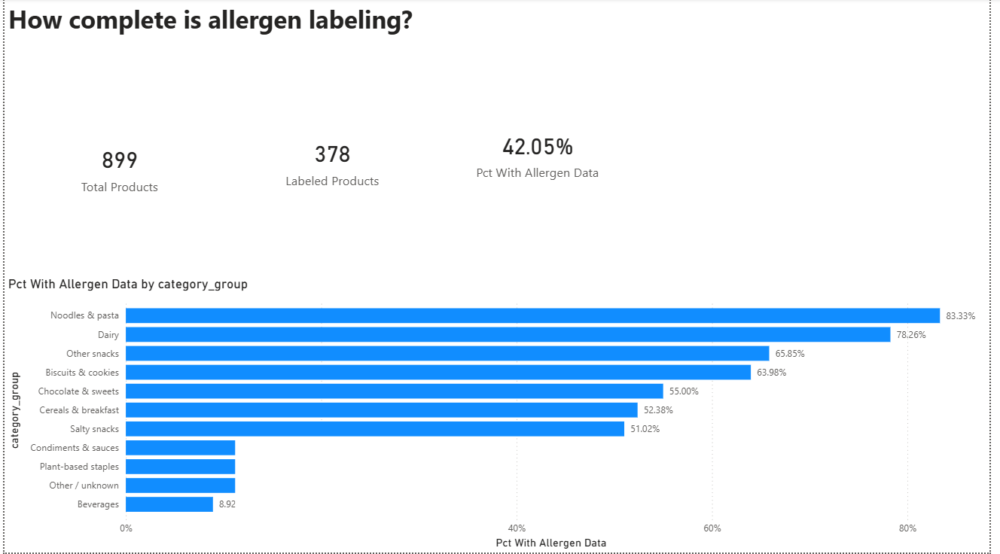
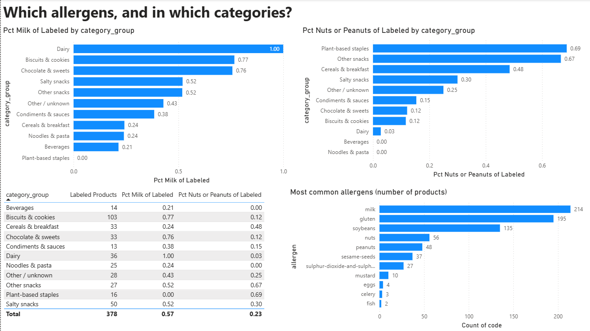

# Allergen Labeling in Indian Packaged Foods

An analysis of allergen information on packaged foods sold in India, using crowd-sourced Open Food Facts data. Built with Python, SQL (SQLite) and Power BI.

This project is based on the same domain as my app [Allergy Tracer](YOUR-APP-LINK): I built the app, then analyzed the kind of data it relies on.

## Questions
1. Which allergens appear most often?
2. Which food categories carry the most milk and nut/peanut allergens?
3. How complete is the allergen data, and where are the gaps?

## Dashboard

## Key findings
- **Allergen data is missing for most categories' products.** Only 378 of 899 products (42.05%) list any allergen. Beverages are the biggest gap: 8.9% (14 of 157) list allergens, compared with 83.3% of noodles and pasta and 78.3% of dairy.
- **Milk, gluten and soy dominate.** Among the 378 labeled products, milk appears in 56.6%, gluten in 51.6% and soy in 35.7%. Nuts (14.8%) and peanuts (12.7%) follow.
- **Milk is concentrated in a few categories.** It appears in 100% of labeled dairy (36 products), 76.7% of biscuits and cookies (103) and 75.8% of chocolate and sweets (33).
- **Nuts and peanuts cluster in snacks and cereals.** Plant-based staples (68.8%, 16 labeled products), other snacks (66.7%, 27) and cereals and breakfast (48.5%, 33) are highest. Biscuits are 11.7%, and noodles and beverages have none.
- **"May contain" traces warnings are rare.** Only 8.2% of products have traces data. The most common warnings are milk, gluten, nuts and soy.
- **Data quality issues exist.** 22 products have non-standard allergen entries, such as "apple", "orange" or "none", which I excluded from allergen counts.

## Method
1. Collected 899 products from the Open Food Facts API (`scripts/`).
2. Cleaned and split allergen, traces and category fields with pandas in Google Colab (`allergen_analysis.ipynb`).
3. Loaded the tables into SQLite and answered 8 business questions with SQL.
4. Exported the cleaned tables (`data/`) and built a 2-page Power BI dashboard (`allergen_dashboard.pbix`).

## Limitations
- The sample is the first 899 products the API returned, not a random sample of all Indian products, so results may not represent the whole market.
- Open Food Facts is crowd-sourced. An empty allergen field can mean "no allergens" or "nobody filled it in", and the data cannot tell these apart. Allergen percentages cover only the 42% of products that list allergens.
- Categories were grouped with keyword rules and are approximate. 142 products fall under "Other / unknown".
- Some categories have small samples (for example 13 to 16 labeled products in condiments and plant-based staples), so their percentages can swing a lot.

## Data source
Data from [Open Food Facts](https://world.openfoodfacts.org), available under the Open Database License (ODbL).

## Tools
Python (pandas), SQL (SQLite), Google Colab, Power BI Desktop
